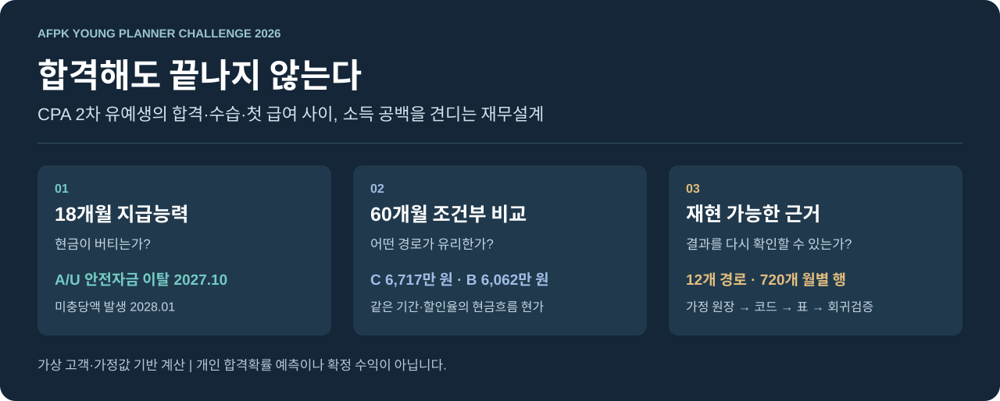
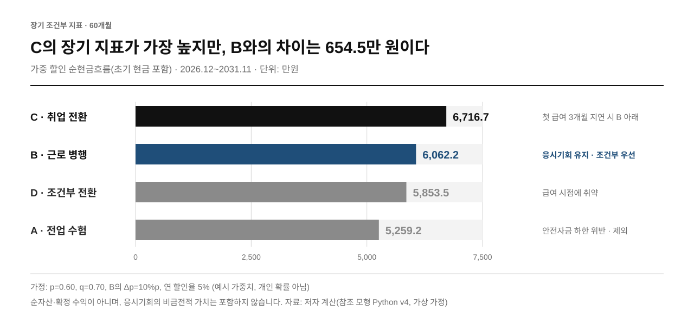
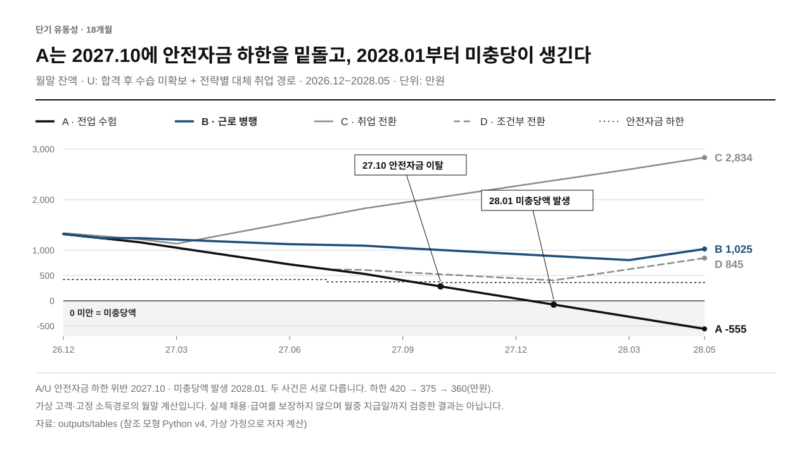
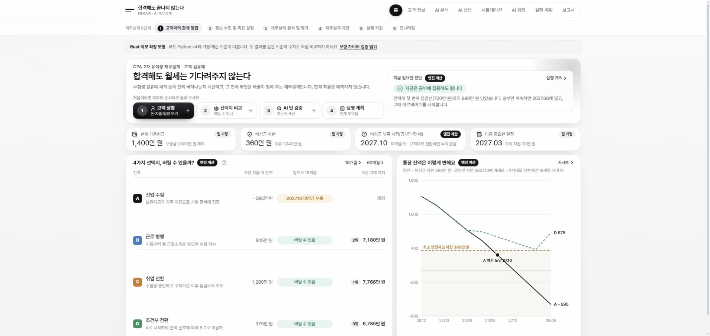

# 합격해도 끝나지 않는다

**합격 발표와 첫 급여 사이, 고객의 현금은 버틸 수 있을까?**

CPA 2차 유예생의 소득 공백을 **18개월 유동성 → 60개월 조건부 가치 → 고객의 선택**으로 연결하는 AI 보조 재무설계 연구입니다.

[](https://github.com/jujinho03/afpk-cpa-financial-planning-2026/actions/workflows/ci.yml)




*그림 1. 핵심 결과 요약. 자료: `outputs/tables`(참조 모형 Python v4, 가상 가정).*

**[심사위원용 3분 안내](docs/JUDGES_GUIDE.md) · [분석 결과 JSON](outputs/tables/model_summary.json) · [프로젝트 기획서 PDF](docs/bible/AFPK_CPA_아이디어_기획서.pdf) · [재현·기여 안내](CONTRIBUTING.md)**

> AFPK 영 플래너 챌린지 2026 · B안 가상 고객 사례. 현재 공개본은 **계산을 재현할 수 있는 연구·협업 저장소**입니다. 기존 Rust 데모와 제공된 AI 원출력 8건을 인수했습니다. 두 금융 모형의 가정이 다릅니다. 팀의 최종 금융 판정과 권고 반영 기록은 공식 참가작(부록)에 있으며 이 저장소에는 두지 않습니다. 이 저장소는 공식 DOCX/HWP 참가작을 대체하지 않습니다.

## Executive Summary

| 구분 | 핵심 내용 |
|---|---|
| **문제** | CPA에 합격해도 수습·채용·첫 급여까지 소득 공백이 남는다. 그 기간의 생활비와 지급의무를 감당할 수 있는가 |
| **발견 1** | A(전업 수험)는 세 결과 모두 2027.10에 안전자금 하한을 밑돈다. 미충당은 그보다 늦은 2028.01에 처음 생긴다 |
| **발견 2** | C(취업 전환)의 60개월 지표가 6,716.7만 원으로 가장 높지만, 첫 급여가 3개월 늦으면 5,968.6만 원으로 B(6,062.2만 원) 아래가 된다 |
| **발견 3** | B(근로 병행)는 최소 여유 445만 원이고 시간제 첫 급여 5개월 미수령까지 하한을 지킨다. D는 1개월 미수령으로 하한을 밑돈다 |
| **결정** | 응시기회 보존을 중시하는 고객에게 **B를 조건부로 우선 검토**한다. 계약·첫 입금을 확인하고, 조건이 깨지면 C를 다시 비교한다. D는 위험을 공개하고, A는 제외한다 |

모든 수치는 가상 고객·가정값으로 계산한 결과이며 개인의 합격·취업 예측이 아니다. **목차:** [1. 문제](#1-문제-정의--합격-이후에도-소득-공백이-남는다) · [2. 결과](#2-결과--단기-안전자금을-통과한-대안-중-b를-조건부로-우선-검토한다) · [3. 민감도](#3-민감도--잔액이-회복돼도-중간의-위험은-사라지지-않는다) · [4. AI 검증](#4-ai-검증--ai의-가치는-답변보다-검증-가능한-수정에-있다) · [5. 웹 데모](#5-기존-웹-데모--별도-rust-확장-모형) · [6. 재현](#6-재현-방법--표준-라이브러리만으로-같은-결과를-다시-만든다) · [7. 저장소 지도](#7-저장소-지도) · [8. 팀](#8-팀과-제출-기준)

## 1. 문제 정의 — 합격 이후에도 소득 공백이 남는다

가상 고객 김유예는 현금 **1,400만 원**, 월 필수생활비 **120만 원**, 학자금대출 **1,600만 원**을 보유한 CPA 2차 유예생입니다. 가족 지원은 단계적으로 종료됩니다. 현재 1차 합격에 따른 마지막 유예 응시 기회를 활용하려면 시험 전 생활비뿐 아니라 **합격 이후 수습·채용·첫 지급까지의 대기기간**도 감당해야 합니다.

이 프로젝트는 세 질문에 답합니다.

1. **언제 위험해지는가?** 월별 안전자금 하한과 실제 미충당액 발생을 따로 찾습니다.
2. **어떤 대안이 있는가?** 전업·근로 병행·취업 전환·조건부 전환을 같은 기간과 단위로 비교합니다.
3. **무엇이 바뀌면 권고도 바뀌는가?** 급여 지연과 공부시간 손실을 드러내고, 최종 선택은 고객의 선호와 실행 가능성에 연결합니다.

## 2. 결과 — 단기 안전자금을 통과한 대안 중 B를 조건부로 우선 검토한다

**아래 숫자는 가상 임금·일정·가중치를 넣어 실제 코드로 계산한 값입니다. 개인의 합격·취업 가능성을 추정한 결과가 아닙니다.**

*표 1. 전략별 단기 안전자금 검사와 60개월 조건부 지표(단위: 만 원). 자료: `outputs/tables/model_summary.json`, `sensitivity.json`.*

| 전략 | 행동 | 18개월 안전자금 검사 | 급여 차질 내성 | 60개월 가중 현금흐름 현가 | 판단 |
|---|---|---|---|---:|---|
| **A · 전업 수험** | 소득 없이 시험 준비 후 결과별 구직 | 세 결과 모두 2027.10 하한 위반 | — | 5,259.2만 원 | 제외 |
| **B · 근로 병행** | 시간제 근로 후 결과별 정규직 전환 | 통과, 최소 여유 445만 원 | 시간제 첫 급여 **5개월** 미수령까지 하한 유지 | 6,062.2만 원 | **조건부 우선 검토** |
| **C · 취업 전환** | 2027.04 첫 일반직 급여 가정 | 통과, 최소 여유 710만 원 | 첫 급여 3개월 지연 시 지표가 B 아래로 | **6,716.7만 원** | 응시기회 포기 시 재비교 |
| **D · 조건부 전환** | 시험 후 시간제 → 정규직 | 통과, 최소 여유 45만 원 | 시간제 **1개월** 미수령으로 하한 위반 | 5,853.5만 원 | 위험 공개 후 보조 검토 |

**해석:** C의 장기 지표가 가장 높지만, 그 우위는 첫 급여 일정 하나에 기대고 있습니다. 응시기회 보존을 중시하는 이 고객에게는 **B를 조건부로 우선 검토**합니다. B는 안전자금 여유가 크고 시간제 급여 차질에도 오래 버팁니다. 대신 C와의 지표 차이 **654.5만 원**과 공부시간 감소를 고객에게 설명합니다. 또 실제 계약·첫 입금을 확인하고, 2027.06 말까지 입금이 없으면 B를 계획에서 내립니다. A는 안전자금 기준에서 제외하고, D는 여유가 얇다는 점을 공개합니다.



*그림 2. 60개월 조건부 장기 지표(초기 현금 포함, 2026.12~2031.11, 단위: 만 원). 자료: `outputs/tables/model_summary.json`.*

지표는 **초기 현금 + 60개월 순현금흐름의 현재가치**입니다. 순자산·투자수익·확정 급여가 아닙니다. p=0.60, q=0.70, B의 Δp=0.10은 예시 가중치이며 집단 합격률에서 개인화하지 않았습니다. [가정 전체 보기](docs/assumptions/BASELINE.md)

## 3. 민감도 — 잔액이 회복돼도, 중간의 위험은 사라지지 않는다



*그림 3. 합격·수습 미확보(U) 경로의 18개월 월말 잔액과 안전자금 하한(2026.12~2028.05, 단위: 만 원). 자료: `outputs/tables/monthly_cashflows.csv`.*

- **A/U:** 2027.10 잔액 285만 원으로 안전자금 360만 원을 밑돕니다. 미충당액이 처음 생기는 시점은 그보다 늦은 **2028.01**입니다.
- **D/U:** 정규직 첫 급여가 1개월 늦으면 하한 위 여유가 **5만 원**, 2개월 늦으면 2028.03에 하한을 **35만 원** 밑돕니다.
- **C:** 첫 급여를 3개월 늦추면 장기 지표가 **5,968.6만 원**으로 낮아져 B의 기본값 아래로 내려갑니다.
- **B vs D (시간제 첫 급여 미수령):** B는 5개월을 받지 못해도 세 결과 모두에서 하한을 지킵니다(B/U 여유 45만 원). D/U·D/F는 1개월만으로 2028.01에 하한을 밑돕니다. [계산 결과](outputs/tables/sensitivity.json)의 `parttime_first_pay_delay`이며, 급여가 늦게 들어오는 것보다 불리한 '받지 못함' 가정입니다.

이는 **현재 가정을 유지한 시나리오 비교**입니다. 채용 보장이나 안전 확률이 아닙니다. 월말 계산은 월중의 월세·급여 지급 순서까지 확인하지 않습니다. [수치와 한계 읽기](docs/JUDGES_GUIDE.md)

## 4. AI 검증 — AI의 가치는 ‘답변’보다 ‘검증 가능한 수정’에 있다

AI는 정보 누락·실패 시나리오·권고의 반례·고객 설명을 제안하고, 인간은 공식 자료와 독립 계산으로 판단합니다. 목표는 **AI 원출력 → 근거 대조 → 재계산 → 고객 권고 변경**을 추적하는 것입니다.

| 이 저장소에서 확인할 수 있는 것 | 이 저장소에 없거나 검증 범위 밖인 것 |
|---|---|
| Python v4의 12개 경로·720행 계산 결과와 회귀·경계조건 테스트 | 팀의 최종 금융 판정과 권고 반영 기록은 공식 참가작(부록)에 있으며 이 저장소에는 두지 않습니다 |
| 선정 AI 주장23개의 [독립 계산·근거 대조](ai_evidence/CLAIM_AUDIT.md)와 재현 코드 | 해당 코드 실행을 사람의 승인이나 제공자 호출 증명으로 대체할 수 없음 |
| 원본 파일 해시, 가정 원장, 알려진 결함, E1~E8 제공 원출력 8건·23개 주장 | 제공자 측 과거 호출의 독립 입증, 법정 ICL·급여·채용기간의 현실성 검증 |
| 기존 React/Rust 데모 소스와 원본 커밋, 실행·빌드용 CI | 외부 LLM 재호출·유료 기능·외부 배포는 이번 검증 범위 밖 |

[AI 실험 증거 구조](ai_evidence/README.md) · [알려진 모형 한계](docs/decisions/KNOWN_LIMITATIONS.md) · [데모 인수 상태](docs/demo/DEMO_INTAKE_REPORT.md)

## 5. 기존 웹 데모 — 별도 Rust 확장 모형

팀의 AI 담당이 작성한 React·TypeScript·Vite 프런트엔드와 Rust·Axum·SQLite 백엔드를 원본 커밋 [`bd5a625`](https://github.com/jujinho03/afpk-cpa-financial-planning-2026/commit/bd5a62518f07f4f738a1c1ec69d4c697d7345ccb)의 이력을 보존해 인수했습니다.

**데모는 별도 Rust 확장 모형입니다.** 위의 Python v4 차트와 임금·급여월·안전자금·할인 정의가 다릅니다. 동일 조건의 독립 검산이나 동일 숫자를 보장하는 화면으로 해석하지 않습니다. [두 모형 비교](docs/demo/DEMO_BIBLE_GAP_ANALYSIS.md)



*2026-11-12 로컬 검수 화면. 위 Python 표와 다른 Rust 가정을 사용합니다. 입력 변경·재계산·복원과 8개 화면을 확인했으며, 외부 AI 호출 없이 실행했습니다.*

| 실제 경로 | 기능 |
|---|---|
| `/` · `/client` | 고객 요약·가상 입력과 가정 편집 |
| `/canvas` · `/copilot` | 규칙 기반 분석·상담, 선택적 서버 측 Gemini 연결 |
| `/simulator` | Rust 전략·지연·민감도 계산 |
| `/verification` | 제공된 AI 원출력·주장 대조와 인간 판단 기록 |
| `/plan` · `/report` | 월별 점검·재계산·보고서 및 브라우저 인쇄 |

검증 환경은 Node.js 22 LTS와 Rust stable이며, Windows에서는 MSVC C++ 도구가 필요합니다. 프런트의 `.nvmrc`는 22를 지정합니다. 외부 AI 키 없이 로컬 합성 데모를 실행할 수 있습니다.

```sh
# 터미널 1 — 작업 디렉터리를 backend로 유지
cd apps/demo/backend
cargo run --locked

# 터미널 2 — 저장소 루트에서 시작
cd apps/demo/frontend
npm ci
npm run dev -- --host 127.0.0.1
```

브라우저는 `http://127.0.0.1:5173`, API는 `http://127.0.0.1:8080`입니다. Windows MSVC 환경 설정은 [데모 실행 안내](apps/demo/README.md)를 참조합니다. 서버는 loopback에만 바인딩합니다. 사용자 인증이 완성된 공개 서비스가 아니므로 터널·외부 배포용으로 사용하지 않습니다.

[실제 인수·실행 검증](docs/demo/DEMO_INTAKE_REPORT.md) · [AI 기록의 출처와 번호 매핑](ai_evidence/README.md)

## 6. 재현 방법 — 표준 라이브러리만으로 같은 결과를 다시 만든다

참조 모형·테스트·SVG 생성은 **Python 표준 라이브러리만** 사용합니다. Python 3.10 이상에서 다음 순서로 실행합니다.

```sh
git clone https://github.com/jujinho03/afpk-cpa-financial-planning-2026.git
cd afpk-cpa-financial-planning-2026
python scripts/reproduce.py
python scripts/render_figures.py
python -m unittest discover -s tests -v
python scripts/check_repository.py
```

`outputs/tables/`의 JSON·CSV에서 그림을 생성합니다. CI는 테스트와 원본 해시를 검사하고 표·그림 재생성 후 Git diff가 없는지도 확인합니다. 알려진 결함을 재현하는 테스트는 **결함 해결 또는 금융 타당성 승인**을 의미하지 않습니다.

## 7. 저장소 지도

결론(`outputs/`)은 계산 코드(`src/`)가 가정(`docs/assumptions/`)으로부터 만들어 내고, 테스트(`tests/`)가 그 과정을 고정합니다. 화살표 방향으로 따라가면 모든 숫자의 출처에 닿습니다.

**가정** `docs/assumptions/BASELINE.md` → **계산** `src/afpk_cpa/financial/model_v4.py` → **표 생성** `scripts/reproduce.py` → **결과** `outputs/tables/*.json·csv` → **그림 생성** `scripts/render_figures.py` → **그림** `outputs/figures/*.svg`

| 폴더 | 역할 | 먼저 볼 파일 |
|---|---|---|
| [`docs/`](docs/README.md) | 심사 안내, 가정, 한계, 출처, 기획서 | [3분 안내](docs/JUDGES_GUIDE.md), [가정 원장](docs/assumptions/BASELINE.md), [한계 원장](docs/decisions/KNOWN_LIMITATIONS.md) |
| [`outputs/`](outputs/figures/README.md) | 코드가 생성한 결과(손으로 고치지 않음) | [요약 JSON](outputs/tables/model_summary.json), [민감도 JSON](outputs/tables/sensitivity.json), [720행 CSV](outputs/tables/monthly_cashflows.csv) |
| `src/afpk_cpa/financial/` | 참조 계산 모형(Python 표준 라이브러리) | [model_v4.py](src/afpk_cpa/financial/model_v4.py) |
| `scripts/` | 표 재현·그림 생성·저장소 점검·데모 smoke 검사 | [reproduce.py](scripts/reproduce.py), [check_repository.py](scripts/check_repository.py) |
| `tests/` | 기준값 고정·경계조건·알려진 결함 재현 테스트 | [test_model_v4.py](tests/test_model_v4.py), [test_reproduce.py](tests/test_reproduce.py) |
| [`ai_evidence/`](ai_evidence/README.md) | AI 실험 원출력의 출처·상태·번호 대응 | [증거 구조](ai_evidence/README.md) |
| [`apps/demo/`](apps/demo/README.md) | 기존 React·Rust 웹 데모(별도 확장 모형) | [데모 실행 안내](apps/demo/README.md), [두 모형 차이](docs/demo/DEMO_BIBLE_GAP_ANALYSIS.md) |
| `vendor/v4/` | 처음 받은 v4 원본(SHA-256 고정, 수정 금지) | [원본 설명](vendor/v4/README.txt) |
| `reports/` | 원고 위치 안내만 둠. 최종 참가작(본문+부록 통합본)과 서명 서류는 이 저장소에 올리지 않음 | [안내](reports/drafts/README.md) |
| `.github/` | CI(Python·Rust·프런트 검사), Issue·PR 양식 | [CI 설정](.github/workflows/ci.yml) |

협업 규칙은 [AGENTS.md](AGENTS.md)와 [기여 안내](CONTRIBUTING.md), 변경 이력은 [CHANGELOG](CHANGELOG.md)에 있습니다.

## 8. 팀과 제출 기준

3인 팀이며, 블라인드 심사를 위해 이 문서에는 역할만 적습니다.

| 역할 | 책임 |
|---|---|
| 팀장 · 재무분석 | 고객 가정·재무분석·본문·최종 권고 |
| AI 담당 | 기존 데모·AI 검증·기술서 |
| 통합 담당 | 데모 통합·환경·테스트·CI·문서 빌드 |

**제출 기준:** 2026-11-16 23:59 KST. 공식 참가작은 재무설계 본문+AI 기술서 DOCX/HWP 1개이며, 서명 확인서는 별도입니다. 공개 저장소와 제출용 익명 참가작은 구분합니다. [공개 범위·검토 기록](docs/decisions/PUBLIC_RELEASE.md)
