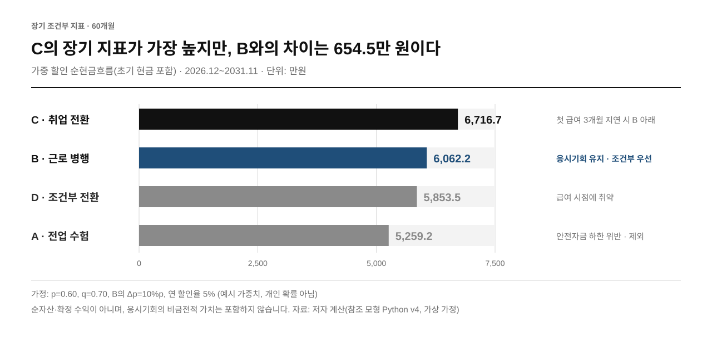

# 심사위원을 위한 3분 안내

**확인할 질문:** CPA 합격 가능성이 아니라, 첫 급여까지의 소득 공백을 고객이 감당할 수 있는가?

이 문서는 현재 저장소에서 확인할 수 있는 계산·근거·한계를 안내합니다. 공식 제출용 재무설계 본문과 AI 기술서를 대신하지 않습니다.

> **결론 먼저.** A(전업 수험)는 2027.10에 안전자금 하한을 밑돌아 제외합니다. C(취업 전환)의 60개월 지표가 가장 높지만 첫 급여 일정에 의존합니다. 응시기회 보존을 중시하는 이 고객에게는 B(근로 병행)를 계약·첫 입금 확인을 조건으로 우선 검토합니다.

## 1분 — 판단 순서: 지급의무와 안전자금을 장기 가치보다 먼저 본다

가상 고객은 현금 1,400만 원, 보증금 1,000만 원, ICL 1,600만 원을 보유합니다. 생활비는 월 120만 원이고 가족 지원은 종료됩니다. 보증금을 생활비 가용현금에서 제외하고, 현 시점의 유예 응시 기회와 경제적 자립을 함께 고려합니다.

*표 1. 판단 순서와 확인 자료.*

| 판단 순서 | 답해야 할 질문 | 확인 자료 |
|---|---|---|
| ① 지출 충당 | 어느 달부터 잔액이 음수가 되는가? | 월별 CSV의 `raw_cash`, `unfunded` |
| ② 안전자금 | 필수비용 3개월분을 유지하는가? | `cmin`, `first_safety_violation_18` |
| ③ 장기 가치 | 안전 조건을 통과한 대안의 가치는? | 60개월 가중 할인 현금흐름 |
| ④ 고객 합의 | 응시 기회 보존에 얼마를 감수할 것인가? | B/C 차이와 실행 일정·고객 선호 |

**안전자금 하한 위반 ≠ 지급불능.** A/U는 2027.10에 하한을 위반하지만, 최초 미충당액은 2028.01에 생깁니다. A/P는 중간 안전자금 기준을 위반하면서도 기본 18개월 월말 잔액이 음수가 되지는 않습니다.

## 2분 — 결과와 반례: C의 우위는 첫 급여 일정 하나에 기댄다



*그림 1. 60개월 조건부 장기 지표(초기 현금 포함, 단위: 만 원). 자료: `outputs/tables/model_summary.json`.*

기본 가정에서는 C 6,716.7만 원 > B 6,062.2만 원 > D 5,853.5만 원 > A 5,259.2만 원입니다. A는 안전자금 기준을 위반하므로 장기 숫자가 있다고 실행 가능해지는 것은 아닙니다.

**권고:** 응시기회 보존을 중시하는 이 고객에게는 B를 **조건부로 우선 검토**합니다. C의 장기 우위는 첫 급여 일정에 크게 의존하고, B는 안전자금 여유가 크며 급여 차질에도 오래 버팁니다. 실제 계약·첫 입금이 확인되지 않으면 B를 확정하지 않고 C를 다시 비교합니다.

*표 2. 결과를 바꾸는 조건(민감도). 자료: `outputs/tables/sensitivity.json`.*

| 결과를 바꾸는 조건 | 실제 계산값 | 해석 |
|---|---:|---|
| C의 첫 급여를 2027.04 → 07로 지연 | 5,968.6만 원 | B 기본값보다 낮아짐. 실제 취업 시점이 중요 |
| D/U 첫 정규직 급여 1개월 지연 | 최소 안전자금 여유 5만 원 | 통과하더라도 여유가 작음 |
| D/U 첫 정규직 급여 2개월 지연 | 2028.03 잔액 325만 원, 하한 360만 원 | 5월 잔액이 회복돼도 중간 위반은 남음 |
| B의 Δp 0 → 15%p | 약 6,266 → 5,960만 원 | 근로 병행의 공부시간 비용을 숨기지 않음 |
| B 시간제 첫 급여 5개월 미수령 | 세 결과 모두 하한 유지, B/U 최소 여유 45만 원 | 6개월이면 B/U 2028.03 위반 |
| D 시간제 첫 급여 1개월 미수령 | D/U·D/F 최소 여유 -35만 원 | 2028.01 하한 위반. D의 여유가 얇음 |

시간제 미수령 행은 기본 경로의 월별 결과를 그대로 두고 앞에서부터 k개월의 시간제 급여를 받지 못한 것으로 처리한 단기 18개월 계산입니다(`sensitivity.json`의 `parttime_first_pay_delay`). 이 값은 참조 모형의 시나리오 계산입니다. 개인 확률·채용 보장·실측 임금이 아닙니다. B/C 차이 654.5만 원은 응시 기회의 가격을 직접 측정한 것이 아니라, 설정한 소득경로 간 지표 차이입니다.

## 3분 — 근거: 모든 주장에 확인할 파일이 있다

*표 3. 주장과 근거 파일.*

| 확인할 주장 | 현재 근거 | 남은 조건 |
|---|---|---|
| 계산 재현 가능 | [JSON](../outputs/tables/model_summary.json), [720행 CSV](../outputs/tables/monthly_cashflows.csv), [코드](../src/afpk_cpa/financial/model_v4.py), [테스트](../tests/) | 현실 타당성과는 별도 |
| 가정과 공식 자료 구분 | [가정 원장](assumptions/BASELINE.md), [출처](references/README.md) | 실제 임금·채용기간·ICL 의무 검증 |
| 코드·본문 불일치 공개 | [알려진 한계](decisions/KNOWN_LIMITATIONS.md) | 날짜 정규화·입력 검증·생성기 통합 |
| AI 원출력 비판적 검증 | [제공된 8건·23개 주장](../ai_evidence/README.md) | 이번에 재호출하지 않음, 인간 최종 판정·권고 수정 대기 |
| 기존 데모와 금융 계산 연결 | [인수 보고](demo/DEMO_INTAKE_REPORT.md), [모형 차이](demo/DEMO_BIBLE_GAP_ANALYSIS.md) | Rust 확장 모형과 Python v4를 구분, 동일 결과를 보장하는 포트 아님 |

## 웹 데모와 참조 모형의 관계

루트 그림은 Python v4, 웹앱은 Rust 확장 모형입니다. 기본 임금·첫 급여월·안전자금·수험비·PV 정의가 다릅니다. 데모를 열 때 화면의 프로필 안내와 [차이 표](demo/DEMO_BIBLE_GAP_ANALYSIS.md)를 함께 확인합니다. 제공 원출력은 과거 데모 가정의 기록이며 현재 Python v4 실험 실적으로 그대로 전용하지 않습니다.

## 숫자의 의미

- 60개월 지표는 **초기 현금 + 할인 순현금흐름**이며 순자산·투자수익이 아닙니다.
- p/q/Δp는 예시 가중치입니다. 집단 CPA 합격률을 특정 고객의 확률로 쓰지 않습니다.
- ICL은 2029.01 이후 월 20만 원의 **자발적 상환 가정**입니다. 법정 의무상환액·이자·잔액 추적은 미구현입니다.
- 음수 이후의 조달 방법·비용, 물가·실직·월중 입출금은 충분히 모델링하지 않았습니다.
- 장기 `job_delay`의 달력 오류는 보존된 알려진 결함입니다. 현재 제시한 1~3개월 예시와 장기 지연을 구분합니다.

## 직접 확인하는 명령

```sh
python scripts/reproduce.py
python scripts/render_figures.py
python -m unittest discover -s tests -v
python scripts/check_repository.py
```

표와 그림은 동일한 JSON·CSV에서 재생성됩니다. 테스트는 계산과 알려진 결함의 재현을 확인하며, 외부 AI 실험이나 금융 자문 적합성 검증을 대체하지 않습니다.

[전체 기획서](bible/AFPK_CPA_아이디어_기획서.md) · [기획서 PDF](bible/AFPK_CPA_아이디어_기획서.pdf) · [README로 돌아가기](../README.md)
